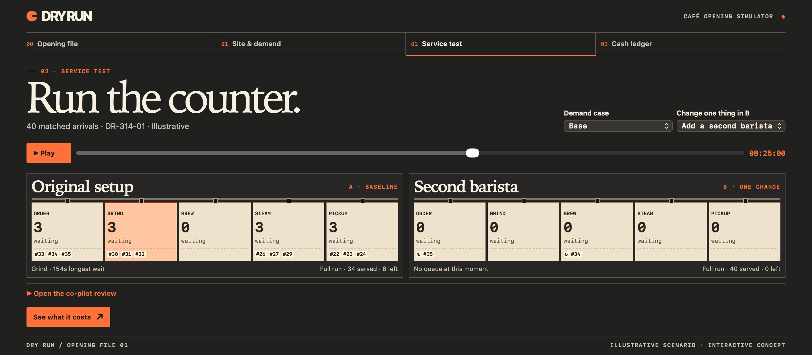

# Cafe Dry Run

Test a café Saturday, and the cash it takes to survive it, before you sign the lease.

You pick a site, set how busy it gets, simulate service, compare a staffing or equipment change, and read the cash runway. You and an agent edit the same saved scenarios through the same actions. The agent is not a chatbot sitting next to a private board.

This is an [Agent-Native](https://www.agent-native.com/docs/) app, built for the [Builder.io Agent-Native Hackathon](https://www.builder.io/hackathon).



## What you can do

- Place the shop and set Saturday demand, including customers per hour and opening hours.
- Run a service test and watch wait times, lost customers, and the bottleneck.
- Compare one change at a time, such as a second barista or another piece of equipment.
- Inspect break-even and cash runway from the same saved inputs.
- Ask the agent to explain a saved comparison, or to apply a change through the same actions you use.

The demand form rejects values it cannot use, such as a close time before the open time, or more than 1,000 customers an hour. Service and cash keep using the last saved demand until you fix the form and save.

## Run it locally

You need Node.js 22.22 or later and pnpm 10.

```bash
git clone https://github.com/VasuBansal7576/cafe-dry-run.git
cd cafe-dry-run/cafe-app
corepack enable
pnpm install --frozen-lockfile
pnpm dev
```

Open the URL the dev server prints.

The board, the simulations, and the comparisons run without a model. Live agent chat needs a supported provider. A local Grok bridge is documented in [`cafe-app/README.md`](cafe-app/README.md).

## Checks

```bash
pnpm -C cafe-app typecheck
pnpm -C cafe-app exec vitest run server/lib/cafe
pnpm -C cafe-app agent-native:doctor
```

## Repository layout

| Path | What it is |
| --- | --- |
| [`cafe-app/`](cafe-app/) | The running application |
| [`DESIGN.md`](DESIGN.md) | Visual design |
| [`cafe-dry-run-statechart.html`](cafe-dry-run-statechart.html) | Behavior and action contracts |
| [`design-reference/`](design-reference/) | Screen references and an offline preview |

## Prior work

The design and the statechart existed before the 9 November 2026 repository prep. The work in this repository since then is the Agent-Native café app and the shared founder and agent workflow.
